<a href="https://stxic-labs.vercel.app" target="_blank">
  <picture>
    <source media="(prefers-color-scheme: dark)" srcset="./assets/optical-banner-dark.svg" />
    <source media="(prefers-color-scheme: light)" srcset="./assets/optical-banner-light.svg" />
    
  </picture>
</a>

<a href="https://christianlascuna.dev" target="_blank">
  <picture>
    <source media="(prefers-color-scheme: dark)" srcset="./assets/hero-dark.svg" />
    <source media="(prefers-color-scheme: light)" srcset="./assets/hero-light.svg" />
    
  </picture>
</a>

  

  <a href="https://christianlascuna.dev"><b>PORTFOLIO</b> &middot; christianlascuna.dev</a>
  &nbsp;&nbsp;&middot;&nbsp;&nbsp;
  <a href="https://stxic-labs.vercel.app"><b>LABS</b> &middot; stxic-labs.vercel.app</a>
  &nbsp;&nbsp;&middot;&nbsp;&nbsp;
  <a href="mailto:c.lascuna556171@umindanao.edu.ph"><b>DIRECT LINE</b></a>
  &nbsp;&nbsp;&middot;&nbsp;&nbsp;
  <a href="https://linkedin.com/in/christian-lascuna"><b>LINKEDIN</b></a>

 

### `01 // THE OPTICAL SPECIMEN ARCHIVE`

  <a href="https://github.com/clascuna556171/roninclips">
    <picture>
      <source media="(prefers-color-scheme: dark)" srcset="./assets/specimen-roninclips-dark.svg" />
      <source media="(prefers-color-scheme: light)" srcset="./assets/specimen-roninclips-light.svg" />
      
    </picture>
  </a>
  &nbsp;
  <a href="https://github.com/clascuna556171/pollyskill">
    <picture>
      <source media="(prefers-color-scheme: dark)" srcset="./assets/specimen-polyskill-dark.svg" />
      <source media="(prefers-color-scheme: light)" srcset="./assets/specimen-polyskill-light.svg" />
      
    </picture>
  </a>

  <a href="https://github.com/clascuna556171/shoeboy">
    <picture>
      <source media="(prefers-color-scheme: dark)" srcset="./assets/specimen-shoeboy-dark.svg" />
      <source media="(prefers-color-scheme: light)" srcset="./assets/specimen-shoeboy-light.svg" />
      
    </picture>
  </a>
  &nbsp;
  <a href="https://github.com/clascuna556171/stxic-halo">
    <picture>
      <source media="(prefers-color-scheme: dark)" srcset="./assets/specimen-halo-dark.svg" />
      <source media="(prefers-color-scheme: light)" srcset="./assets/specimen-halo-light.svg" />
      
    </picture>
  </a>

<b>INDEX // COMPLETE CATALOGED ARTIFACTS (PRJ-03 — PRJ-12)</b> &mdash; Expand full STXIC Labs ledger

 

| Index | Specimen | Status | Architecture Summary | Access |
| :--- | :--- | :--- | :--- | :--- |
| `PRJ-03` | **AI Ticket Automator** | `Prototype` | Async FastAPI + Redis/RQ support triage &amp; HMAC-signed webhooks | *Private* |
| `PRJ-04` | **STXIC Atlas** | `In Development` | Local-first Git impact explorer &amp; cited Ollama diff review | [Repo](https://github.com/clascuna556171/stxic-atlas) &middot; [Demo](https://stxic-atlas.vercel.app) |
| `PRJ-05` | **Worthi** | `Shipped` | Flutter app adding 24&ndash;72h cooling friction to impulse purchases | [Live](https://worthi-ten.vercel.app/) |
| `PRJ-07` | **PawfectMatch** | `Shipped` | Pet adoption platform &amp; shelter dashboard (`Laravel 11`, `MySQL`) | [Repo](https://github.com/clascuna556171/pawfect-match) |
| `PRJ-08` | **CyberNex POS** | `Shipped` | Desktop POS with role separation &amp; ReportLab PDF receipts (`PyQt6`) | [Repo](https://github.com/clascuna556171/CyberNexPOS) |
| `PRJ-09` | **STXIC Life OS** | `In Development` | Privacy-first student OS: vault, Blackboard automation &amp; Groq/Ollama digest | [Repo](https://github.com/clascuna556171/stxic-os) &middot; [Live](https://stxic-os.vercel.app) |
| `PRJ-11` | **STXIC.CL** | `Prototype` | Kinetic portfolio with GSAP/Lenis motion &amp; grounded Groq concierge | *Archive* |
| `PRJ-12` | **STXIC Realm** | `In Development` | Personal social web space with server-validated shared homes | [Repo](https://github.com/clascuna556171/stxic-realm) |

Explore every interactive glass folder and architectural trade-off at <a href="https://stxic-labs.vercel.app"><b>stxic-labs.vercel.app</b></a>.

 

<picture>
  <source media="(prefers-color-scheme: dark)" srcset="./assets/dossier-dark.svg" />
  <source media="(prefers-color-scheme: light)" srcset="./assets/dossier-light.svg" />
  
</picture>

  

<a href="https://christianlascuna.dev">
  <picture>
    <source media="(prefers-color-scheme: dark)" srcset="./assets/colophon-dark.svg" />
    <source media="(prefers-color-scheme: light)" srcset="./assets/colophon-light.svg" />
    
  </picture>
</a>

